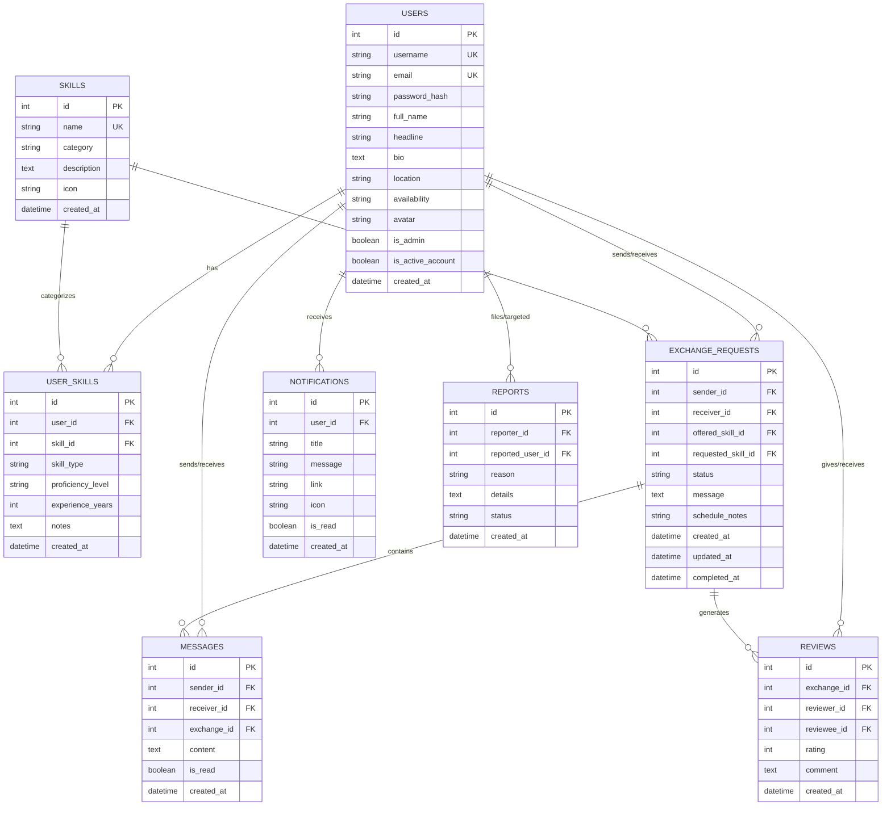

# Smart Swap – Peer-to-Peer Knowledge Exchange Platform

**Smart Swap** is a web-based peer-to-peer knowledge exchange platform where users share their skills and expertise with others in exchange for learning new skills—eliminating financial barriers to personal and professional growth. Instead of paying tuition or subscription fees, users trade skills directly (for example: teaching Python in return for learning Graphic Design & Figma).

---

## 🌟 Key Highlights & Features

### 1. User Authentication & Profile Management
- Secure user registration and login with password hashing via **Werkzeug**.
- Session management using **Flask-Login** with "Remember Me" support.
- Comprehensive user profiles: full name, headline, bio, location, schedule availability (Weekends, Evenings, Flexible, Remote).
- Profile picture uploads and dynamic SVG avatar generation.
- Public profile pages showcasing ratings, completed swaps, skills taught, skills wanted, and verified member reviews.

### 2. Skill Exchange System
- Users list skills they can **teach** (with proficiency: Beginner, Intermediate, Advanced, Expert, plus years of experience and specialized notes).
- Users list skills they want to **learn** (with target goals).
- Explore directory across 8 domain categories (Programming & Tech, Design & Creative, Languages, Business & Marketing, Music & Arts, Health & Fitness, Academics & Writing, Other).
- Instant skill creation in directory if a user teaches an unlisted subject.

### 3. Intelligent Smart Matching Engine (`matching.py`)
Intelligent matching algorithm that computes a transparent **0–100% Compatibility Score**:
- **Mutual 2-Way Match Bonus (+55% to +70%)**: Highest priority given to reciprocal pairs (User A teaches what User B wants AND User B teaches what User A wants).
- **One-Way Skill Match (+25% to +35%)**: When a user teaches what you want or wants what you teach.
- **Proficiency & Mentorship Multiplier (+10%)**: Extra points when a teacher has Advanced/Expert proficiency.
- **Availability Alignment (+10%)**: Compatible schedules (e.g., both Flexible or matching preferred times).
- **Location / Mode Compatibility (+10%)**: Local proximity or Remote-friendly learning modes.
- **Reputation Boost (+5% to +10%)**: Rewarding top-rated members (4.5★+).
- Visual match tiers: **Perfect Mutual Match** (85%+), **Strong Match** (70%+), **Good Match** (50%+), and **Skill Match**.

### 4. Search and Advanced Filtering
- Full-text search across skills, keywords, instructor names, and bios.
- Filter by:
  - Skill category
  - Experience / proficiency level
  - User location (city or remote)
  - Time availability
  - Skill type (People Offering to Teach vs. People Looking to Learn)

### 5. Real-Time Messaging System
- Direct communication between prospective or active exchange partners.
- Live chat window with automatic message scrolling and message timestamps.
- AJAX-based messaging endpoint (`/api/messages/<partner_id>`) for real-time chat without page reloads.
- Unread message counters and badge polling (`/api/unread-count`).

### 6. Full Exchange Lifecycle Management
- **Request**: Propose an exchange specifying what you offer, what you want, proposed schedule, and custom introductory proposal.
- **Incoming / Outgoing Tracking**: Tabbed management for Incoming, Active, Sent, Completed, and Declined swaps.
- **Accept / Decline / Cancel**: Recipient can accept or decline; sender can cancel pending proposals.
- **Complete**: Either party marks the exchange as completed once sessions are finished.
- **Reviews & Ratings**: Both parties submit 1 to 5-star ratings and written reviews which update public reputations.

### 7. Modern Dashboard
- 5 KPI metric cards: Total skills offered, Skills wanted, Pending requests, Active exchanges, Completed exchanges.
- Recommended Exchange Partners widget powered by the Smart Matching Engine.
- Pending incoming proposal alerts with 1-click action buttons.
- Active exchange quick access with direct links to chat.

### 8. Admin Control Center (`/admin`)
- Accessible only to administrators (`is_admin=True`).
- Platform KPI metrics: total registered users, active vs suspended users, directory skills, completion rate.
- **Interactive Chart.js Visualizations**: Category distribution doughnut chart and exchange activity bar chart.
- **User Management**: View all members, search by email/username, suspend/activate accounts, toggle admin privileges.
- **Skill Directory Management**: Add new skills, edit, monitor teacher/learner ratios, remove obsolete skills.
- **Exchanges Monitor**: Track all platform exchanges across every status.
- **Moderation & Safety Reports**: Review user reports, mark resolved or dismissed, take moderation actions.

### 9. Academic Presentation & Defense Features
- **Algorithm Inspector Modal**: Accessible on the Smart Match page, breaking down the exact mathematical formula ($W_{\text{skill}} + W_{\text{prof}} + W_{\text{sched}} + \dots$).
- **Integrated Virtual Classroom (Jitsi Meet)**: 1-click encrypted video call with screen sharing on active swaps (`/exchanges/<id>/meet`).
- **Official Knowledge Exchange Certificate**: Downloadable & printable certificate of completion with verification hash and gold border (`/exchanges/<id>/certificate`).
- **System Architecture & ER Diagram Page**: Comprehensive technical specifications page (`/architecture`) detailing the MVC blueprint pattern, database normalization, and security models.

---

## 💻 Technology Stack

| Layer | Technology |
|---|---|
| **Language** | Python 3.12 / 3.14 |
| **Backend Framework** | Flask 3.0.3 |
| **Database ORM** | SQLAlchemy 2.1.9 & Flask-SQLAlchemy 3.1.1 |
| **Database Engine** | SQLite (zero-config, portable) / MySQL compatible |
| **Authentication** | Flask-Login 0.6.3 & Werkzeug 3.0.3 |
| **Forms & Validation** | Flask-WTF 1.2.1, WTForms 3.1.2, email-validator |
| **Frontend UI** | HTML5, CSS3, JavaScript (Fetch API), Bootstrap 5.3.3, Bootstrap Icons |

---

## 🗄️ Database Schema Design

The database incorporates 8 interconnected tables with foreign key constraints, indexes, and cascades:



---

## 📂 Project Structure

```
smart_swap/
├── app.py                      # Application factory, context processors, error handlers
├── config.py                   # Configuration settings (secret key, upload folder, DB URI)
├── extensions.py               # Flask-SQLAlchemy and Flask-Login extensions
├── models.py                   # 8 database models, relationships, and property helpers
├── forms.py                    # Flask-WTF forms and validation schemas
├── matching.py                 # Intelligent Smart Matching algorithm
├── seed_data.py                # Pre-populates 26 skills, 7 users, sample exchanges & reviews
├── test_app.py                 # Automated unit and integration test suite
├── requirements.txt            # Python dependencies
│
├── routes/
│   ├── __init__.py
│   ├── auth.py                 # Login, register, logout, profile edit, manage skills
│   ├── main.py                 # Landing page, dashboard, explore search, smart matching
│   ├── exchanges.py            # Exchange requests, accept/reject, complete, reviews, reports
│   ├── messages.py             # Chat room, conversations list, AJAX polling API
│   └── admin.py                # Admin dashboard, user management, skills, exchanges, reports
│
├── static/
│   ├── css/
│   │   └── style.css           # Custom styles, gradients, stat cards, chat bubbles
│   ├── js/
│   │   └── main.js             # Live AJAX chat, auto-polling unread badges, 1-click login
│   └── uploads/
│       └── avatars/            # Uploaded profile avatars
│
└── templates/
    ├── base.html               # Shared layout, navigation bar, badges, footer
    ├── index.html              # Landing page with stats, how it works, testimonials
    ├── dashboard.html          # User dashboard with stats cards and smart match widgets
    ├── report.html             # User reporting interface
    ├── notifications.html      # Notifications list
    ├── auth/
    │   ├── login.html          # Login card with 1-click demo credential fillers
    │   └── register.html       # Registration with terms and validation
    ├── profile/
    │   ├── view.html           # Public user profile with skills and reviews
    │   ├── edit.html           # Profile details editor
    │   └── manage_skills.html  # Manage teaching and learning skills
    ├── skills/
    │   ├── explore.html        # Search and multi-criteria filter hub
    │   └── detail.html         # Individual skill page showing teachers and learners
    ├── matching/
    │   └── index.html          # Dedicated Smart Matchmaker with score breakdowns
    ├── exchanges/
    │   ├── manage.html         # Tabbed exchange hub (Incoming, Active, Sent, Completed)
    │   ├── request.html        # Propose knowledge exchange form
    │   ├── detail.html         # Exchange timeline, actions, and details
    │   └── review.html         # Star rating and feedback form
    ├── messages/
    │   └── chat.html           # Real-time split-pane messaging room
    ├── admin/
    │   ├── dashboard.html      # Admin overview metrics and platform statistics
    │   ├── users.html          # Member directory and suspension controls
    │   ├── skills.html         # Directory skill manager
    │   ├── exchanges.html      # Global exchange monitor
    │   └── reports.html        # Member moderation reports
    └── errors/
        ├── 404.html
        ├── 403.html
        └── 500.html
```

---

## 🚀 Getting Started

### 1. Environment Setup
In PowerShell or terminal:
```powershell
# Create and activate virtual environment
python -m venv venv
.\venv\Scripts\Activate.ps1

# Install requirements
pip install -r requirements.txt
```

### 2. Seed Sample Data
Initialize the database and populate it with rich, realistic sample accounts, skills, active exchanges, and reviews:
```powershell
python seed_data.py
```

### 3. Run Test Suite
Verify that all unit and lifecycle tests pass:
```powershell
python test_app.py
```

### 4. Start the Application
```powershell
python app.py
```
Open your browser and navigate to: **`http://127.0.0.1:5000`**

---

## 👥 Demo Accounts (Pre-configured)

| User | Role / Specialty | Email | Password |
|---|---|---|---|
| **Alex Chen** | Python & Machine Learning (Wants UI/UX) | `alex@example.com` | `password123` |
| **Sarah Jenkins** | Senior UI/UX & Graphic Design (Wants Python) | `sarah@example.com` | `password123` |
| **Marco Rossi** | Spanish & Italian Polyglot (Wants Guitar) | `marco@example.com` | `password123` |
| **Liam Davis** | Acoustic Guitar & Audio Engineering (Wants Spanish) | `liam@example.com` | `password123` |
| **Priya Patel** | React Frontend & Web Dev (Wants ML & AI) | `priya@example.com` | `password123` |
| **Elena Rostova** | Growth Marketing & Copywriting (Wants French) | `elena@example.com` | `password123` |
| **Platform Admin** | Platform Administrator & Community Steward | `admin@smartswap.com` | `admin123` |

> *Tip:* On the login page, you can click any of the **1-Click Demo Access buttons** to instantly fill in credentials!
